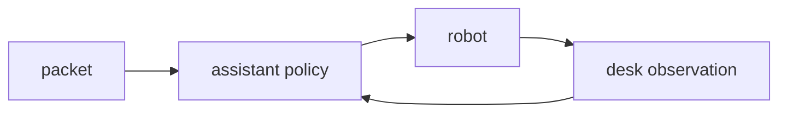

# SAMPLE: RPA runner with a local assistant

> Illustrative sample by Kunjar Bhaduri. The desk, the applicant and the case id are synthetic. No client and no employer. Built by AI coding tools under my direction. October 2026 (America/Chicago).

A small robot executes click, type and read against an in-memory desk. A local assistant reads the screen and picks the next step for one goal, `file_intake`. The home screen starts with a notice that blocks the intake button. The assistant dismisses that notice, opens the form, types the packet, and submits.

This is not UiPath. It is not a UiPath certification, not a UiPath studio project, and not a claim of UiPath delivery.

## Architecture



The robot does not choose. The assistant does not touch fields except by emitting an action. A failed action stops the transcript with the error string.

## Run

Python 3.10 or newer. Standard library only. From this repository:

```bash
python3 -m rpa.demo
python3 -m unittest discover -s tests -v
```

The CI workflow repeats both commands. A passing demo prints `submitted True`.

## Decisions

- An in-memory desk instead of a desktop driver, so CI needs no window server and no vendor license.
- A fixed policy instead of a model call. The policy is the stand-in for an assistant. Swapping in a model later would still return the same action dict.
- The notice is a required first step so a test can prove the assistant recovers before it types.

## Limits

One goal, two fields, three screens. There is no selector engine, no image match, no queue, and no unattended schedule. Nothing here maps to a named RPA product.
